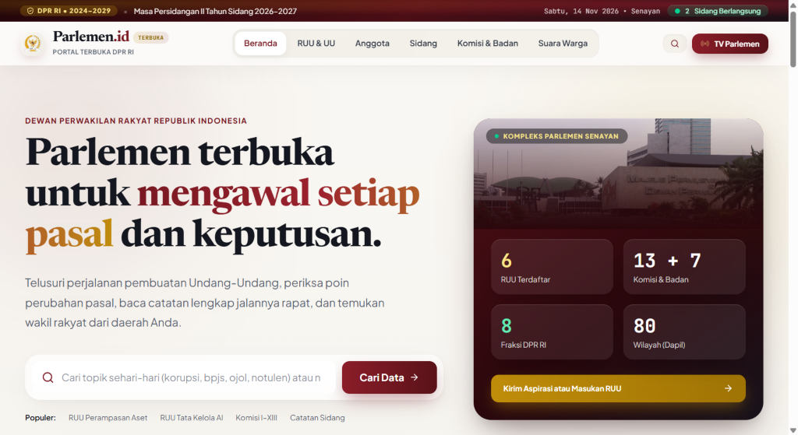
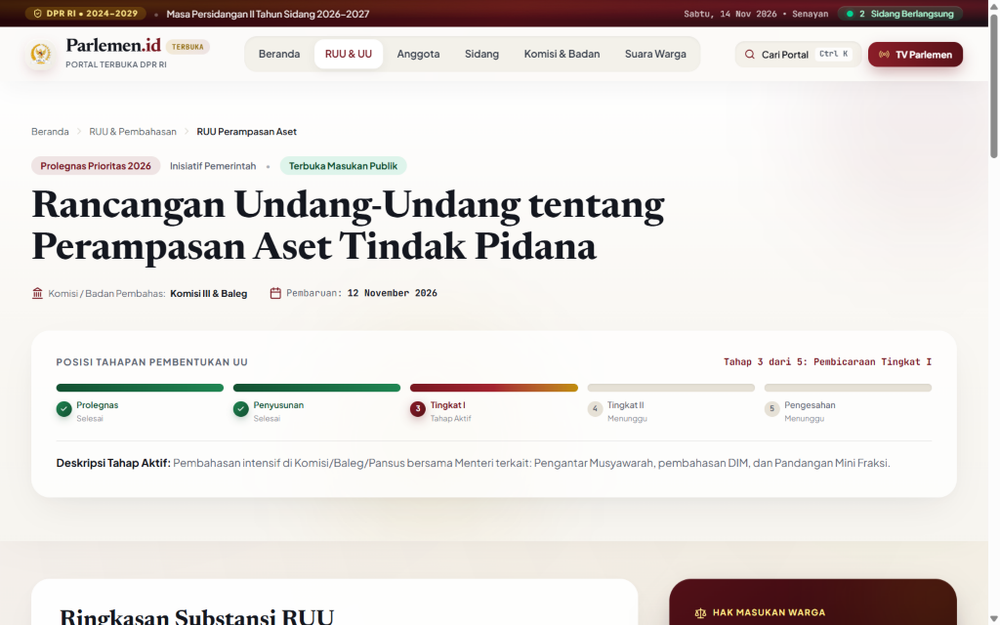
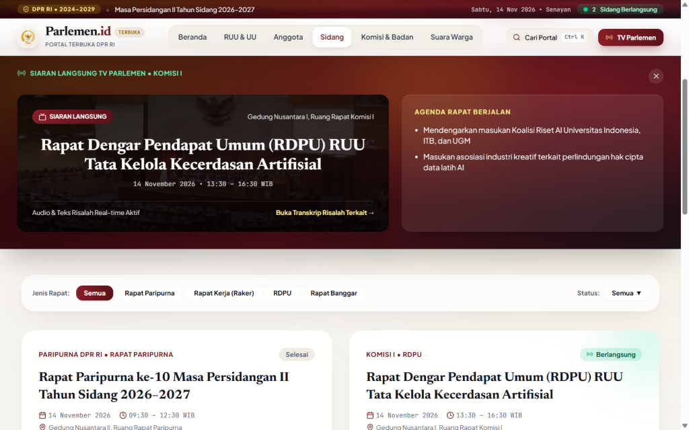

# Parlemen.id — Purwarupa Portal Terbuka Parlemen DPR RI

> **Catatan / Disclaimer:** Ini adalah **proyek pribadi (purwarupa konsep / non-resmi)** yang dibuat untuk keperluan eksplorasi desain antarmuka, arsitektur informasi parlemen, dan portofolio *civic tech*. Seluruh data RUU, profil anggota, jadwal rapat, risalah, dan pengaduan yang tampil di aplikasi ini bersifat simulasi dan **bukan** situs resmi Dewan Perwakilan Rakyat Republik Indonesia ([dpr.go.id](https://www.dpr.go.id)).

---

## Pratinjau Tampilan

### Beranda & Pencarian Cepat


### Pelacakan Tahapan RUU & Matriks DIM


### Jadwal Sidang & TV Parlemen


---

## Ringkasan Proyek

**Parlemen.id** terinspirasi dari pendekatan keterbukaan informasi *UK Parliament (`parliament.uk`)* dan disesuaikan dengan proses bisnis ketatanegaraan **DPR RI** (UU MD3 & Tata Tertib DPR RI), menggunakan bahasa yang ramah untuk masyarakat awam.

### Fitur Utama

- **Pelacakan RUU & Poin Perubahan Pasal (DIM)**
  - Memantau 5 tahapan pembentukan Undang-Undang (Pengajuan → Pengambilan Keputusan Awal / Raker → Pembahasan Tingkat I / DIM → Pengambilan Keputusan Tingkat II / Paripurna → Pengesahan).
  - Matriks perbandingan klaster Daftar Inventarisasi Masalah (DIM) antara Usulan Fraksi DPR RI dan Tanggapan Pemerintah, serta sikap tiap fraksi.
- **Direktori Anggota & 80 Daerah Pemilihan (Dapil)**
  - Filter anggota DPR berdasarkan nama, kabupaten/kota atau provinsi (Dapil), fraksi, dan Alat Kelengkapan Dewan (AKD), lengkap dengan rekam kehadiran dan kutipan rapat.
- **Jadwal Sidang, TV Parlemen & Catatan Sidang (Risalah)**
  - Jadwal Rapat Paripurna, Rapat Kerja, dan RDPU, dilengkapi pemutar simulasi siaran TV Parlemen (`?live=<id>`) yang otomatis menggulir ke pemutar.
  - Arsip Risalah (catatan resmi kata demi kata jalannya rapat) yang bisa dicari dan disalin kutipannya.
- **Komisi I–XIII & 7 Badan DPR RI (AKD)**
  - Direktori lengkap 13 Komisi dan 7 Badan beserta pimpinan, ruang lingkup tugas, dan daftar kementerian/lembaga mitra.
- **Suara Warga (BAM & RDPU)**
  - Formulir simulasi penyampaian usulan pasal RUU dan pengaduan layanan publik dengan nomor tiket pelacakan.
- **Pencarian Cepat Lintas Portal (`Ctrl + K`)**
  - Pencarian global untuk RUU, Anggota, Komisi/Badan, Sidang, dan Risalah dengan **indeks alias istilah awam** (misalnya mencari `korupsi`, `bpjs`, `ojol`, `notulen`, atau `lapor` langsung diarahkan ke RUU/Komisi/halaman terkait).

---

## Tech Stack

- **Framework & Bahasa:** React 19, TypeScript (`strict: true`)
- **Build Tool:** Vite 6
- **Styling:** Tailwind CSS v4 (`@tailwindcss/vite`)
- **Routing & Ikon:** React Router DOM v7, Lucide React

---

## Menjalankan Secara Lokal

Pastikan **Node.js** (disarankan v20+) sudah terpasang.

```bash
# 1. Masuk ke direktori proyek
cd dpr-parliament-id

# 2. Instal dependensi
npm install

# 3. Jalankan server pengembangan
npm run dev

# 4. Cek tipe TypeScript & build produksi
npm run build
```

---

## Struktur Direktori

```text
dpr-parliament-id/
├── public/assets/           # Logo, ilustrasi kursi, & foto teroptimasi (.webp, .svg)
├── src/
│   ├── components/          # Navbar, Footer, Layout, GlobalSearchModal, PageHeader, dll.
│   ├── data/                # Data simulasi DPR RI (RUU, Anggota, AKD, Sidang, Risalah)
│   ├── pages/               # Halaman Beranda, Legislasi, Anggota, Sidang, AKD, Partisipasi
│   ├── utils/               # Mesin indeks pencarian cepat & kamus alias awam
│   ├── App.tsx              # Konfigurasi rute aplikasi
│   └── index.css            # Design system & utilitas Tailwind v4
├── index.html
├── package.json
└── vite.config.ts
```

---

## Atribusi Aset

Aset visual institusional di `public/assets/` (`dpr-logo.svg`, `dpr-seats-2024-2029.svg`, `dpr-building.webp`, `dpr-paripurna.webp`) bersumber dari Wikimedia Commons (artikel [Dewan Perwakilan Rakyat Republik Indonesia](https://id.wikipedia.org/wiki/Dewan_Perwakilan_Rakyat_Republik_Indonesia)) dan dioptimalkan untuk performa web.
